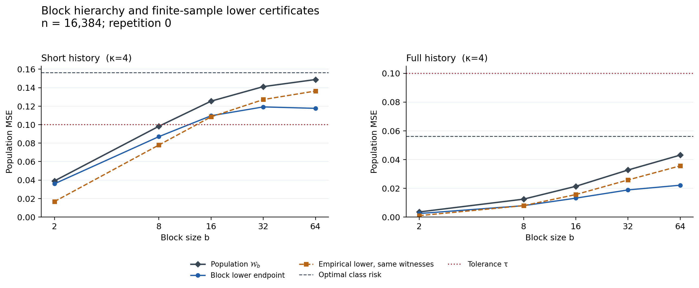

# Risk certificates for representation-based prediction

**Version 0.2.0 · Apache-2.0 · Standalone implementation and scientific documentation**

This project demonstrates **risk certification for prescribed representation–decoder
classes** in a finite-state forecasting task. Each class fixes a feature
representation, a feature pseudometric, and a Lipschitz decoder constraint. It combines lower confidence bounds on
optimal class risk with upper confidence bounds on fitted-predictor risk. The
result can establish that every decoder in a class exceeds a mean squared
error (MSE) threshold, establish that an admissible fitted predictor meets the
threshold, or leave the decision unresolved.

The self-contained documentation specifies the implementation, mathematical
definitions, proofs, assumptions, benchmark, and recorded experiments.

[Scientific reference](docs/SCIENTIFIC_REFERENCE.md) ·
[Quick start](docs/QUICKSTART.md) ·
[Class-risk guide](docs/LOWER_CERTIFICATES.md) ·
[Recorded results](reports/lower_certificates_v1/report.md) ·
[Software citation](CITATION.md)

## The scientific question

Let $X\in\mathcal X$ denote the observed history and $Y$ the scalar prediction
target. Fix a measurable representation $\Gamma:\mathcal X\to\mathcal U$,
a measurable finite-valued feature pseudometric $d$ on $\mathcal U$, a
Lipschitz bound $\kappa\geq0$, an evaluation law for $(X,Y)$, and a known
bounded interval $I$ containing both targets and decoder predictions.
The **optimal class risk** is

```math
R_\kappa^*=\inf_{g\in\mathcal G_\kappa(d)}
\mathbb E[(Y-g(\Gamma(X)))^2],
\qquad
\mathcal G_\kappa(d)=\{g:\mathcal U\to I\text{ measurable}:
|g(u)-g(v)|\leq\kappa d(u,v)\quad\forall u,v\in\mathcal U\}.
```

For a fixed MSE threshold $\tau$, a lower confidence bound $L$ and a
fitted-predictor upper confidence bound $U_{\mathrm{fit}}$ support these decisions:

| Decision | Required evidence | Interpretation |
| --- | --- | --- |
| `class_excluded` | $L>\tau$ | Every decoder in the declared class exceeds the threshold. |
| `requirement_met` | An admissible fitted predictor with $U_{\mathrm{fit}}\leq\tau$ | The fitted predictor and its class meet the threshold. |
| `unresolved` | Available bounds establish neither conclusion | The available evidence does not determine whether the class meets the requirement. |

A fitted predictor outside the declared class can still have a valid upper
bound on its own risk. Its fitted-risk upper endpoint is not used as an upper
bound on the class optimum without an admissibility argument.
Numerical unavailability and conflicting outcomes are recorded separately.
These are population-MSE statements, not prediction intervals for
individual observations.

## Install the complete project

Use Python **3.12 or newer**. Clone the repository, then install the package:

```bash
git clone https://github.com/MohitKumarRostock/certified-kahm-representations-forecasting.git
cd certified-kahm-representations-forecasting
python -m pip install .
```

For a reproducible scientific reference, also record the exact commit with
`git rev-parse HEAD`; [CITATION.md](CITATION.md) describes version and run
identification. The wheel contains the package. The complete checkout or GitHub
source archive additionally contains documentation, tests, figures, and
recorded experiment evidence.

## Verify the recorded class-risk experiment

This is the shortest route to checking the supplied results:

```bash
python -m zipfile -e reports/lower_certificates_v1/full_verification_bundle.zip runs/retained-class-risk
python -m kahm_demo verify-class-risk --run runs/retained-class-risk/run
```

Use a new extraction directory. Verification checks the source identities,
calibration observations, optimization witnesses, confidence endpoints,
admissibility, decisions, and population audit. It does not refit models or
solve new optimization problems. It replays the saved pseudorandom stream in
memory to check the identities of the recorded observations.

The ZIP is a **numerical verification bundle**, including the assessment's
source snapshot. It is not a substitute for the complete software checkout.
The [manifest](reports/lower_certificates_v1/manifest.json) identifies the
verification bundle, study plan, summary, and development wheel by SHA-256.

## Run a separate class-risk assessment

```bash
python -m kahm_demo class-risk --freeze frozen/primary/freeze.json --output runs/class-risk --run-id local-class-risk-v1
python -m kahm_demo verify-class-risk --run runs/class-risk
```

The output directory must be new. Defaults assess RAW, KAHM MEM, and KAHM LOCAL
at Lipschitz bound `2`, and short- and full-history controls at bound `4`.
The run declares 4,096 calibration episodes, block sizes `2, 8, 16, 32, 64`, and
a joint failure budget of `0.05` across all 60 endpoints before generating its
calibration observations. Reusing a seed and run identity replays the same
observations; it does not create an independent repetition.

A larger planned assessment can declare all sample sizes together:

```bash
python -m kahm_demo class-risk --freeze frozen/primary/freeze.json --output runs/class-risk-study --sample-sizes 1024 4096 16384 --block-sizes 2 8 16 32 64 --run-id local-class-risk-study-v1
```

The [class-risk guide](docs/LOWER_CERTIFICATES.md) explains every option and
saved record. The same observations and optimization witnesses support two
lower-confidence constructions: expected block-score bounds and
empirical-risk-based bounds. A separate full empirical optimization is also
reported. Unresolved outcomes, numerical failures, and realized coverage misses
are retained.

## Scientific results

The supplied study fixes five classes, three calibration sizes, five block
sizes, and **180 one-sided confidence endpoints** with total failure
allocation `0.05`. At 4,096 calibration episodes and $\tau=0.1$:

| Representation–decoder class | Class-risk lower bound $L$ | Fitted-risk upper bound $U_{\mathrm{fit}}$ | Fitted table admissible? | Decision |
| --- | ---: | ---: | :---: | --- |
| RAW, $\kappa=2$ | 0.042810136 | 0.072272782 | Yes | Requirement met |
| KAHM MEM, $\kappa=2$ | 0.114702961 | 0.072272781 | No | Class excluded |
| KAHM LOCAL, $\kappa=2$ | 0.042810136 | 0.072272781 | Yes | Requirement met |
| Short history, $\kappa=4$ | 0.134763734 | 0.180788316 | Yes | Class excluded |
| Full history, $\kappa=4$ | 0.042810136 | 0.072272784 | Yes | Requirement met |

These are descriptive decimal approximations; exact stored fractions govern
all decisions. The MEM fitted-risk upper bound is valid for that predictor,
but its inadmissibility prevents using the endpoint as an upper bound on
optimal class risk. The stored assessment reports these two facts separately. MEM remains unresolved at 1,024 episodes. At 16,384 episodes,
short-history blocks of sizes 16, 32, and 64 establish exclusion that the
pairwise bound misses. The full empirical-optimum certificate is stronger in
this small benchmark; no computational advantage of blocking is established.



The [study report](reports/lower_certificates_v1/report.md) contains the
interpretation, all three figures, and replay commands. The
[machine-readable summary](reports/lower_certificates_v1/summary.json) retains
all 15 class/sample-size assessments, including the unresolved case. The
[scientific reference](docs/SCIENTIFIC_REFERENCE.md) explains what these results
establish and their limits.

## Representations and benchmark

The finite benchmark predicts the next scalar observation from two past
observations. Each observation is in `{0, 0.25, 0.75, 1}`: there are 16 possible
histories and 64 history-target cases. Calibration assumes iid episodes from
the declared law, independent of development. The known finite law is used for
a separate population audit after the sample certificates have been issued.

| Representation | Features supplied to the readout |
| --- | --- |
| RAW | Training-standardized observed history |
| KAHM MEM | Relative local reconstruction affinities, normalized within each partition |
| KAHM LOCAL | The same memberships plus membership-weighted local coordinates |

MEM and LOCAL use the same fitted Gaussian Kernel Affine Hull Machine (KAHM)
bank. Memberships describe local geometry; they are not calibrated probabilities
of latent regimes. The fitted readout uses Gaussian Nyström features, ridge
regression, and output clipping. Feature widths and total search effort differ.

For class-risk assessment, saved feature and prediction tables are exact
finite-support computational functions. Euclidean geometry is assessed before
the readout's internal column scaling. An admissible table has a Lipschitz
extension, but the check does not establish global regularity of the
nonlinear executable readout. In particular, the MEM exclusion is specific to
its coordinates, metric, and Lipschitz bound; it does not establish unrestricted
information loss. See [benchmark](docs/BENCHMARK.md),
[encoder design](docs/ENCODER_DESIGN.md), and [readout design](docs/READOUT_DESIGN.md).

## Fit and assess new predictors

The fitted-predictor workflow fits, freezes, and assesses three forecasting models:

```bash
python -m kahm_demo reproduce --output runs/fresh-models --master-seed 20261110 --run-id fresh-models-v0.2
python -m kahm_demo class-risk --freeze runs/fresh-models/frozen/freeze.json --output runs/fresh-class-risk --run-id fresh-class-risk-v0.2
```

`reproduce` generates development data, fits all 225 declared configurations,
selects and freezes predictors, calibrates fitted-risk upper bounds, and
performs a separate population audit. The second command assesses those frozen
models using its own declared class-risk calibration stream. All outcomes and
partial failures are retained. A completed workflow need not meet the risk
threshold.

## Inspect the fitted-predictor experiment

The `public-v0.1.0` experiment supplies the fitted-predictor example. Inspect it with:

```bash
python -m kahm_demo tutorial --project . --mode inspect --history 0.25 0.75
```

History order is **previous observation, current observation**. Inspection
checks archive identities and displays stored values; it does not replay the
models or reverify their numerical certificates. Strict replay of
`public-v0.1.0` requires the unmodified `v0.1.0` sources and exact recorded
numerical runtime. Each separately executed experiment records its own
source and runtime identities. [CI.md](docs/CI.md) explains the separate verification gates.

The [guided notebook](notebooks/01_kahm_certified_forecasting.ipynb) and
[static HTML walkthrough](notebooks/01_kahm_certified_forecasting.html) teach
this fitted-predictor example. Install `python -m pip install '.[tutorial]'` for
JupyterLab. The notebook defaults to inspection; running all cells does not fit
models or draw calibration data. The class-risk workflow is covered by its
[standalone guide](docs/LOWER_CERTIFICATES.md) and recorded study.

## Documentation map

| Document | Purpose |
| --- | --- |
| [Scientific reference](docs/SCIENTIFIC_REFERENCE.md) | Definitions, terminology, hierarchy, statistical guarantees, and interpretation |
| [Class-risk guide](docs/LOWER_CERTIFICATES.md) | Commands, numerical objects, study design, and recorded outputs |
| [Class-risk proof](docs/LOWER_CERTIFICATE_PROOF.md) | Self-contained derivation of the lower and upper guarantees |
| [Fitted-risk guarantee](docs/FITTED_RISK_GUARANTEE.md) | The bounded-loss upper-confidence construction |
| [Certificates explained](docs/CERTIFICATES_EXPLAINED.md) | Decisions and the distinction between a class and a fitted predictor |
| [Method overview](docs/METHOD_OVERVIEW.md) and [technical overview](docs/TECHNICAL_OVERVIEW.md) | Implementation map, APIs, and artifact lifecycle |
| [Freeze interface](docs/FREEZE_INTERFACE.md) and [population audit](docs/POPULATION_AUDIT.md) | Provenance checks and independent known-law references |
| [Adapting to new data](docs/ADAPTING_TO_NEW_DATA.md) | What must be specified and implemented for another task |
| [CI](docs/CI.md) and [release guide](docs/RELEASE_GUIDE.md) | Tests, packaging, and preservation of scientific evidence |

The package has no generic CSV or arbitrary time-series adapter. A new task
requires an appropriate data interface, target bounds, sampling model, metric,
and decoder class. Overlapping trajectory windows are not automatically iid.
The demonstrator makes no general forecasting-superiority, computation-saving,
Koopman-closure, or certified latent-rollout claim.

## Citation, licence, and contributions

Software author: **Mohit Kumar**. Copyright **2026 Mohit Kumar**.
Licensed under [Apache-2.0](LICENSE); see [NOTICE](NOTICE).
[CITATION.cff](CITATION.cff) supplies machine-readable software metadata;
[CITATION.md](CITATION.md) explains how to cite the version, commit, and exact
experiment used. [CONTRIBUTING.md](CONTRIBUTING.md) describes the validation and
evidence-preservation workflow.
