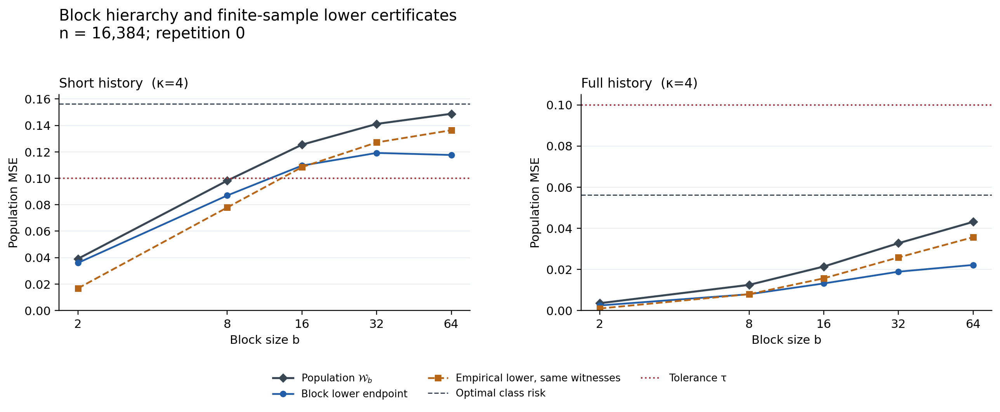
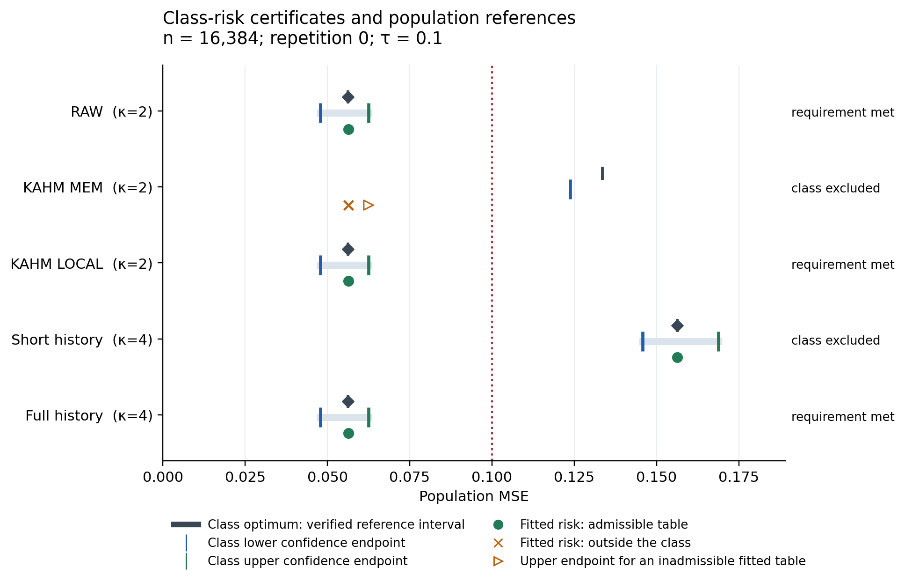
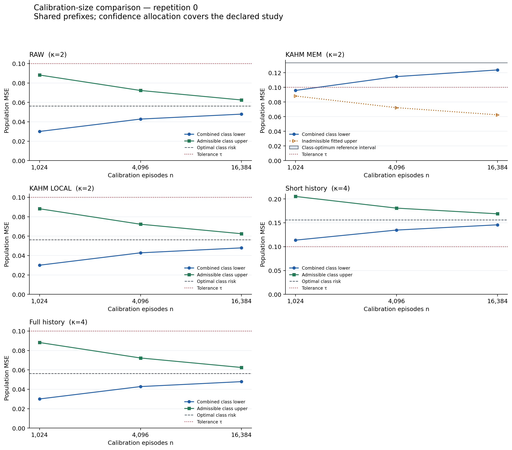

# Verified lower and upper risk certificates: retained study

This directory contains the completed class-risk demonstration for development version **0.2.0**. The complete numerical evidence is in [full_verification_bundle.zip](full_verification_bundle.zip); [summary.json](summary.json) and [run_report.md](run_report.md) expose the outcomes without unpacking it. The [manifest](manifest.json) binds the archive, wheel, plan, and summary with SHA-256 hashes.

## Study design

The plan fixed five classes, calibration prefixes of 1,024, 4,096, and 16,384 episodes, block sizes 2, 8, 16, 32, and 64, and one repetition before generating calibration observations. RAW, KAHM MEM, and KAHM LOCAL use their archived pre-readout coordinates, Euclidean distance, and Lipschitz bound 2. Short and full observation-history controls use unstandardized coordinates and bound 4.

There are 180 one-sided endpoints: each assessment contains a fitted upper endpoint, five block lower endpoints, five empirical-optimum lower endpoints reusing exactly the same block witnesses, and a separate full empirical-optimum lower endpoint. Each receives failure allocation 1/3600; their sum is 0.05. Shared observations and nested prefixes do not require independence between confidence statements.

The calibration sampling model assumes iid episodes independent of development. The one retained study is not an estimate of coverage frequency. The exact known-law population quantities are calculated only after all sample certificates are saved and checked.

## Results at 4,096 calibration episodes

| Class | Combined class lower | Admissible class upper | Decision |
| --- | ---: | ---: | --- |
| raw_k2_1 | 0.042810136 | 0.072272782 | requirement_met |
| kahm_mem_k2_1 | 0.114702961 | — (fitted table is inadmissible) | class_excluded |
| kahm_local_k2_1 | 0.042810136 | 0.072272781 | requirement_met |
| short_history_k4_1 | 0.134763734 | 0.180788316 | class_excluded |
| full_history_k4_1 | 0.042810136 | 0.072272784 | requirement_met |

The MEM class is excluded because its lower certificate exceeds the MSE tolerance 0.1. Its accurate original fitted predictor lies outside the declared Lipschitz class, so that predictor's upper endpoint is recorded separately and is not used as a class upper bound. RAW and LOCAL have admissible fitted tables that satisfy the requirement.

The independent population audit establishes the RAW and LOCAL class optima exactly as 0.05625. It encloses the MEM optimum in a narrow verified interval near 0.13354. This is a result for the specified coordinates, metric, regularity budget, and finite benchmark law. It does not establish unrestricted information loss in MEM.

## The block hierarchy at 16,384 episodes

The short-history class has exact optimal risk 0.15625. Its exact population block quantity is

$$
\mathcal W_b=\frac{5}{32}\frac{b-4+4(3/4)^b}{b-1}.
$$

| Block size | Exact population quantity, approximately | Block lower confidence endpoint | Empirical lower from the same witnesses |
| ---: | ---: | ---: | ---: |
| 2 | 0.039062500 | 0.035951115 | 0.016721425 |
| 8 | 0.098224367 | 0.086999063 | 0.077921545 |
| 16 | 0.125417608 | 0.109597582 | 0.108441504 |
| 32 | 0.141131058 | 0.119175608 | 0.127129834 |
| 64 | 0.148809524 | 0.117628874 | 0.136379103 |

The pairwise certificate remains below 0.1, while blocks of 16, 32, and 64 exclude the short-history class in this sample. The block lower endpoint decreases slightly from size 32 to 64 even though the population hierarchy increases. This is the expected tradeoff between a stronger population quantity and fewer independent blocks. The empirical-optimum route is reported separately rather than assuming either calibration method always dominates.







Vector PDF versions are included beside every PNG. [Figure metadata](figures/figure_manifest.json) binds the plots to the saved study records. The plots describe the retained experiment; they do not run new calculations or select alternative samples.

## Verification and reuse

The original release archive passed identity inspection. All 470 selected portable tests passed with no failures, errors, or skips. After adding an early guard for the supported block-size limit of 2,048, the 37 class-bound/oracle/workflow tests passed again. The final package built and completed a fresh installed-wheel development, model-freeze, upper-certification, and population-audit run. The same final installed wheel also completed the class-risk workflow on its newly fitted models at 1,024 and 4,096 calibration episodes; [those results](installed_class_risk_summary.json) are retained separately. Machine-readable local check reports are included here. Remote CI results belong to the particular reviewed commit and are available from its GitHub Actions run.

The final retained study uses the same declared stream and parameters as the earlier development validation; the change was an input-size guard, and all 15 numerical assessments are identical. This recheck is not counted as another independent repetition.

To verify the complete retained evidence from the matching source checkout:

```bash
python -m pip install .
python -m zipfile -e reports/lower_certificates_v1/full_verification_bundle.zip runs/retained-lower-study
python -m kahm_demo verify-class-risk --run runs/retained-lower-study/run
```

Alternatively install the supplied 0.2.0 wheel into a Python 3.12+ environment with NumPy 2.x. Verification checks retained numerical witnesses and source identities. It does not refit models or rerun optimization; it replays the saved PRNG stream in memory to check observation identity.

To create a separate study with the same scientific design:

```bash
python -m kahm_demo class-risk --freeze frozen/primary/freeze.json --output runs/new-lower-study --sample-sizes 1024 4096 16384 --block-sizes 2 8 16 32 64 --solver-sweeps 100 --master-seed 20261119 --run-id lower-certificates-20261119-v1
```

Reusing that seed and run identity replays the same observations. A genuinely separate planned repetition must have a distinct declared stream, and any joint claim must allocate confidence across the full requested family.

The [user guide](../../docs/LOWER_CERTIFICATES.md) and [mathematical proof](../../docs/LOWER_CERTIFICATE_PROOF.md) specify the claim, numerical verification, and scope. The supplied tables are exact finite-support computational functions. Historical encoder replay, ideal real-arithmetic feature equivalence, and global regularity of the original executable readout are not claimed.
